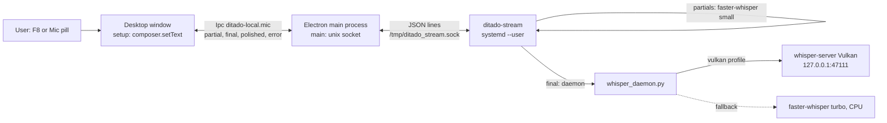

# ditado-local — voice dictation plugin for OpenCode Desktop

GUI plugin for **OpenCode Desktop (v2.2.6+)** that adds voice dictation to the message composer. **F8** toggles recording; a **Mic** pill above the composer shows state and a **live countdown** (`● 00:07 / 03:00`, blinking dot, ⚠ under 30 s). Partial text appears while you speak; the final pass replaces it without duplicating.

> The plugin does **not** transcribe anything. It talks to the local `ditado-stream` service over `/tmp/ditado_stream.sock` (JSON lines). Engine install and service setup live in the [repository root README](../README.md).



The plugin has two parts the app runs separately: `setup` runs per window and writes into the composer (`composer.setText`); `main` runs once in the Electron main process and speaks to the dictation service over the unix socket. They communicate through the `Ipc` declared in `src/gui.tsx`.

## Files

| File | Role |
|---|---|
| `src/gui.tsx` | The whole plugin: `main` (socket + state), `setup` (composer, pill, F8), hallucination filter |
| `vite.config.ts` | Build with the `gui()` preset of `@opencode/plugin`, generates `dist/gui-experimental.cjs` |
| `package.json` | Pinned deps: `@opencode/plugin` 2.2.6 and `effect` 4.1.0 (Schema API version used) |
| `dist/gui-experimental.cjs` | The bundle the app loads (pre-built here) |

## Install

1. Add the absolute path of this folder to the `plugins` key of `~/.config/opencode/opencode.jsonc`:
   ```jsonc
   { "plugins": ["/home/YOU/path/to/opencode-whisper-ditado/plugin-desktop/ditado_desktop"] }
   ```
2. **Close and reopen OpenCode Desktop** (the plugin only loads on startup).
3. F8 or the **Mic** pill. Enter sends the message and feeds the learning layer.

## Behavior notes

- **Send while recording**: sending clears the composer; the dictation is cancelled and late partial/final messages are discarded so the sent box is never rewritten.
- **Polish pass (optional)**: the LLM correction arrives after the final; it is only applied if the composer is exactly what the plugin wrote (you didn't edit/send yet).
- **Whisper hallucinations**: silent endings can produce fake subtitles ("Amara.org", "Obrigado por assistir"…). The plugin filters the common ones.
- **Learning**: on Enter, the diff between delivered and sent text is recorded; the same fix twice promotes a rule into `dicionario.yaml`.

## Measured (Vulkan engine, AMD 780M iGPU)

Plugin logs each dictation to the Desktop `main.log`:

| Dictation | Audio | Stop → final | In service |
|---|---|---|---|
| short | 12.2 s | 1.32 s | 1.32 s |
| medium | 24.8 s | 1.88 s | 1.88 s |
| long | 56.7 s | 4.98 s | 4.97 s |

Nearly all the time is in the service, not in the plugin or the composer write. Known limitation: the pill API only offers slots *above* the composer, not next to the send button.

## Build

```bash
cd ditado_desktop
npx tsc -p tsconfig.json   # type check
npx vite build             # generates dist/gui-experimental.cjs
```

Then reload the Desktop (`/reload` or restart). The GUI plugin API is experimental (`./gui-experimental`) and may change between versions.
